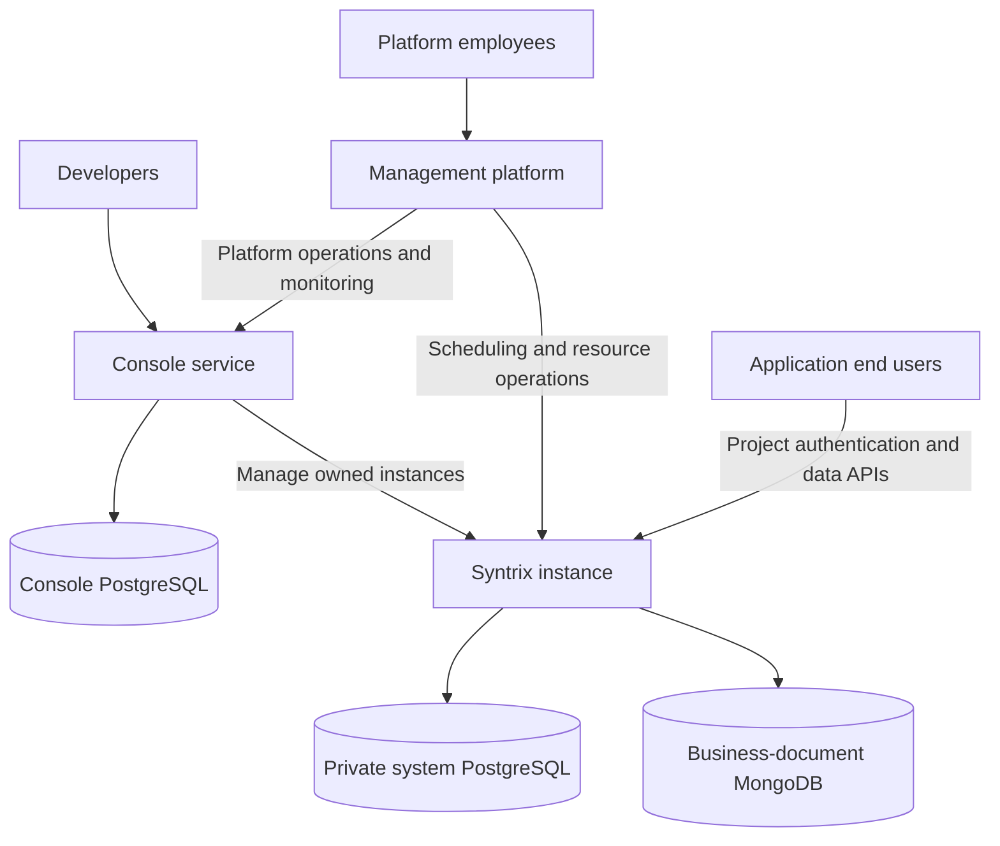
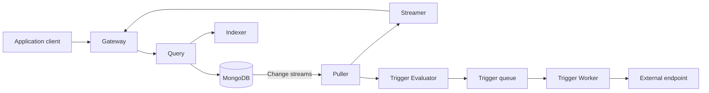

# Syntrix Platform Architecture

**Status:** Accepted target architecture. The implementation status below identifies
the runtime behavior that exists today and the remaining separation work. The
[managed-instance design](design/server/console/03.instance_lifecycle.md) records
the planned shared-infrastructure allocation and Console lifecycle contracts;
the [lifecycle proposal](../.agents/notes/proposed/architecture/2026-10-12-console-instance-lifecycle.md)
owns their rationale and scope.

This document owns the platform's user categories, service boundaries, instance
hierarchy, and database terminology. Component designs and references must use
these meanings. The [boundary decision](../.agents/notes/proposed/architecture/2026-10-10-platform-console-instance-boundaries.md)
records the complete target. The [Console implementation decision](../.agents/notes/implemented/architecture/2026-10-11-console-server-postgres-kubernetes.md)
records its PostgreSQL source data, developer authentication, and Kubernetes
execution/recovery constraints. The [Console client decision](../.agents/notes/implemented/architecture/2026-10-12-console-client-session-and-distribution.md)
owns bilingual browser sessions and independent static distribution.
The [instance deployment decision](../.agents/notes/implemented/architecture/2026-10-12-instance-container-kubernetes.md)
owns the instance container, standalone/distributed Kubernetes templates, and
configuration-driven manifest generation.

## Users and Service Boundaries

| Layer | Users | Responsibility |
|---|---|---|
| Management platform | Syntrix platform employees | Platform-wide scheduling, resource operations, monitoring, and administration |
| Console service | Developers building services with Syntrix | Developer accounts and creation and management of each developer's Syntrix instances |
| Syntrix instance | End users of a developer's applications | Project-scoped identity, authentication, business-document access, queries, and realtime synchronization |

A developer can own one or more instances. Employees administer the platform;
developers manage their own resources through Console. Application end users
authenticate to a project inside an instance. These are distinct account and
authorization domains. An application's `admin` role does not grant Console or
Management privileges.

Management is a platform service outside developer runtime instances. Console is
the developer-facing service. An instance's Identity service manages application
end users. The existing Go `services.Manager` assembles dependencies and manages
process lifecycle; its name does not make it the Management platform.



The diagram expresses the target responsibility and ownership hierarchy, not an
HTTP proxy chain for application requests. Console currently invokes Kubernetes
through a separate provisioning adapter to manage predefined HTTP test workloads.
Console-managed full instance bundles and employee Management execution remain
target work. Operators can deploy current standalone or distributed runtime services
against existing MongoDB/PostgreSQL dependencies using the
[instance deployment guide](../packages/syntrix/deployment/README.md). The planned
Console lifecycle allocates private databases and runtime resources on
administrator-registered shared infrastructure; it does not deploy MongoDB,
PostgreSQL, or NATS server Pods.

## Instances, Projects, and Logical Databases

The hierarchy is:

```text
Developer
  Syntrix instance A
    Project shop
      Project identity realm: users, credentials, OAuth configuration, sessions
      Syntrix database orders
      Syntrix database catalog
    Project forum
      Separate project identity realm
      Syntrix database posts
  Syntrix instance B
    Its own projects, identity realms, and logical databases
```

An instance is the outer runtime and data-isolation boundary. Its projects and
application users belong to that instance. A project owns an isolated identity
realm and can use multiple logical Syntrix databases. Web, mobile, and other
OAuth clients of one project use that project's identity realm; an OAuth client
is not a separate project.

Shared project identity does not grant every user access to every project
database or document. Data access requires the target instance, project, and
database binding plus the applicable application policy. Equal usernames,
emails, role names, or database names across projects or instances do not imply
shared authority or accounts.

For example, an external identity can map to one stable local user in `shop` and
another local user in `forum`. Disabling the shop account affects its project.
Deleting `orders` leaves the shop identity realm available to `catalog`.
Deleting a project requires coordination of its identity realm and databases;
deleting an instance retires its project and runtime resources.

## Database Terminology and Data Ownership

| Term | Meaning | Data ownership |
|---|---|---|
| Console PostgreSQL | Private developer control storage | Developer accounts and sessions, workload ownership, desired state, template snapshots, idempotency, operations, and Kubernetes observations |
| Instance system PostgreSQL | Private storage supporting the operation of one Syntrix instance | Projects, application end users, credentials, OAuth/OIDC providers and clients, sessions, logical-database configuration and metadata, and other system records |
| Syntrix database | The logical document-database product provided to developers | A project's business documents, accessed through Syntrix APIs and SDKs |
| Physical MongoDB database or collection | An implementation storage namespace | Holds business documents for the configured logical Syntrix databases |

Each instance owns Syntrix runtime services, a physical MongoDB database for
business documents, and a private system PostgreSQL database. Database privacy
means separate database namespaces, credentials, and privileges; Console and
multiple instances may share the same PostgreSQL server. PostgreSQL is not a
developer-facing Syntrix database. MongoDB carries developer business documents.
A logical Syntrix database need not correspond one-to-one to a physical MongoDB database or
collection. The [storage design](design/server/core/storage/05.multi-database.md)
owns the physical representation and routing contracts.

Console owns an independent PostgreSQL database for its source data. Kubernetes
provides actual resources and observations; it is not the developer account or
request authority. The supplied deployment hosts Console in `syntrix-platform`,
which also provides a location for future Management services; test workloads
run in `syntrix-tests`. Management's persistence backend remains unchosen. An
instance's PostgreSQL must not be treated as the global employee/developer
account store or platform inventory authority.

The planned managed-instance lifecycle uses administrator-registered MongoDB,
PostgreSQL, and NATS servers and protected privileged credentials. Developers
select a name, runtime mode, profile, and allowed origins. Console allocates a
private MongoDB database and scoped user, a private PostgreSQL database and
scoped role, and distributed trigger artifacts named by immutable instance ID.
A shared NATS account is supported by that target: each instance has its own
stream, subject namespace, and durable consumer; workers of the same instance
share that consumer. Console PostgreSQL will own administrator resource settings,
profiles, instance bindings, desired revisions, lifecycle phases, ownership
receipts, encrypted secrets, and the accepted runtime release/package identity.
For new instances, Console will resolve the latest complete successful published
Syntrix release, download its matching CLI/templates, and freeze the source commit,
archive identity and image index digest before provisioning. Bootstrap, acceptance,
finalization and all runtime roles use that release; retries and ordinary restart
preserve it. This extends its current test-workload records
without moving instance system records into the Console database. The
[managed-instance design](design/server/console/03.instance_lifecycle.md) owns
allocation, reconciliation, deletion, configuration, and the five-PR task sequence.

The operator-managed templates select a namespace, workload names, resource
requests/limits, and replicas through deployment values. Standalone retains one
runtime data claim; distributed placement uses separate Puller and Indexer claims
plus an existing shared signing-key Secret and NATS JetStream. Database installation
and source-data persistence remain external to the manifests. The templates leave
Console's `syntrix-platform` and test-workload namespaces unchanged and do not
establish project realms or Console-owned instance lifecycle records.

System records are exposed through authorized system operations. They are not
ordinary business documents that application document APIs may read or modify.
Sharing an instance's PostgreSQL deployment between system modules does not
merge their record ownership or authorization policy.

## Instance Runtime Services

| Service | Instance responsibility |
|---|---|
| Gateway | Public document, query, and realtime entry points; token validation and application-policy enforcement |
| Identity | Project-scoped end-user accounts, authentication, OAuth/OIDC, external identity mapping, sessions, and token authority |
| Query | Document CRUD and query/replication execution |
| Indexer | Derived indexes and projection lifecycle |
| Puller | MongoDB change ingestion, buffering, and replay for consumers |
| Streamer | Realtime subscriptions and delivery |
| Trigger Evaluator / Worker | Rule evaluation and external event delivery |

Identity is a peer runtime module to Indexer and Puller. Its PostgreSQL records
include project-scoped users and authentication state. It supports both roles:

- Syntrix authenticates a project's end users and issues its own OAuth/OIDC
  credentials to that project's clients.
- Syntrix acts as a client of configured external identity providers, maps the
  external identity into the project's user realm, and establishes a Syntrix
  session.

The [identity architecture](design/server/core/identity/01.architecture.md) owns
these contracts. Management coordinates platform resource operations; Console
is their developer-facing entry. Instance services execute the local catalog,
identity, and data operations within the requested instance and project scope.
Application end-user credentials do not authorize instance provisioning or
platform database-lifecycle requests.

The Go Service Manager wires modules within a process. Standalone uses direct
calls; distributed deployment uses service clients, including when services
share one process. These are deployment choices inside an instance, not the
Management/Console/instance hierarchy. The [runtime architecture](design/server/01.architecture.md)
and [deployment design](design/server/03.deployment_modes.md) own those details.

## Current Runtime Data Flows

The current implementation already provides these document-runtime paths:



Distributed trigger delivery uses NATS JetStream; standalone delivery uses
in-memory pubsub. The realtime Streamer-to-Gateway path does not use the trigger
queue. Go requires the version declared by `packages/syntrix/go.mod`.

## Implementation Status

| Area | Current repository behavior | Accepted target |
|---|---|---|
| Platform Management | A cluster-control proposal exists; the Go Manager provides process composition | Employee-facing platform scheduling, monitoring, and resource management |
| Console | `packages/console-server` owns configured developer authentication and PostgreSQL-backed Kubernetes test workloads; `packages/console-client` supplies bilingual cookie-based login, restoration, logout, and Overview | Full developer-owned Syntrix instance lifecycle and administration |
| Instance deployment | `packages/syntrix` supplies a package-only image, standalone/distributed templates, and strict values-driven manifest generation with persistent runtime data and existing backend connections | Console-managed runtime bundles with private databases on shared infrastructure; employee fleet operations remain separate |
| Identity | `internal/identity` owns current account/authn/config/repositories/runtime and narrow capabilities; Gateway owns HTTP adapters | A peer instance Identity service with project-scoped accounts and both OAuth/OIDC roles |
| Account scope | Independent Console developer accounts and sessions; instance users still combine runtime-global roles and database administration | Separate platform employee, Console developer, and project end-user domains |
| System storage | Console owns separate PostgreSQL source data; instance PostgreSQL stores users/catalog and revocation currently uses MongoDB | Each instance has a private physical PostgreSQL database and scoped role; identity/OAuth/session state belongs there, even when the server is shared |
| Project hierarchy | Existing database metadata and APIs have no project identity realm | Instance-owned projects, project-owned identity realms, and multiple databases per project |

These implementation gaps must remain visible in API references and future
changes. Describing the accepted architecture does not make project-scoped
endpoints, OAuth grants, Console-managed full Syntrix provisioning, or platform
Management
available in the current runtime. The former embedded frontend and Gateway
static route are removed; Console is independently deployed.

Current Gateway [document authorization](design/server/gateway/authorization.md)
owns CEL evaluation, rule configuration, and request/resource types separately
from Identity's account/token implementation. Manager constructs the evaluator
with Query and `GatewayConfig.AuthZ`. Module configurations own their settings
and lifecycle; rule configuration uses YAML `gateway.authz.rules_path`.
The [ownership decision](../.agents/notes/implemented/architecture/2026-10-10-gateway-document-authorization.md)
records the implemented document-policy separation.

[Identity contracts and Gateway authentication](../.agents/notes/implemented/architecture/2026-10-10-identity-contracts-and-gateway-authentication.md)
separate account operations, token verification, and service-token issuance from
HTTP Bearer/context handling. The account service validates opaque verified
actor provenance for administrative list/update while returning noncredential
user views. REST retains its existing blank credential JSON fields and current
admin/system permissions.

[Identity token capabilities](../.agents/notes/implemented/architecture/2026-10-10-identity-token-capabilities.md)
separate the concrete account service, user-token signer, system-token issuer,
and public-key verifier. The verifier holds only a detached public key; Manager
shares it with Gateway and administrative account operations. Current local
API/Trigger Worker composition still loads the configured private key for
issuing capabilities.

[Identity repository/runtime ownership](../.agents/notes/implemented/architecture/2026-10-10-identity-repository-and-runtime-ownership.md)
completes extraction of existing account logic, configuration, repositories,
and administrator bootstrap into the Identity module. Its runtime and the
document/catalog factory borrow named connections from the shared physical
Backends owner, closed once by Manager after consumers stop. Default catalog
bootstrap resolves its owner through Identity only after confirming no default
row exists. Current account IDs, storage, JWTs, grants, and configuration retain
their behavior; key distribution, project/session/OAuth capabilities, and
independent deployment remain target work.

The existing database metadata ID and document namespace are also distinct in
parts of the runtime. Their current meaning remains documented in the
[database architecture](design/server/core/database/01.architecture.md). Future
project/Identity changes may use destructive schema upgrades; no legacy-data
migration or compatibility is required. An explicit development reset remains
an operator action, not an implicit effect of starting Console.

## Related Design Owners

- [Developer Console](design/server/console/01.console.md)
- [Console Managed-Instance Lifecycle and Implementation Tasks](design/server/console/03.instance_lifecycle.md)
- [Platform Management](design/server/console/02.control_plane.md)
- [Instance Identity](design/server/core/identity/01.architecture.md)
- [Gateway Document Authorization](design/server/gateway/authorization.md)
- [Instance Database Catalog and Lifecycle](design/server/core/database/01.architecture.md)
- [Instance Storage](design/server/core/storage/01.architecture.md)
- [Instance Public API Reference](reference/api.md)
- [Console API Reference](reference/console_api.md)
- [TypeScript SDK Reference](reference/typescript_sdk.md)
